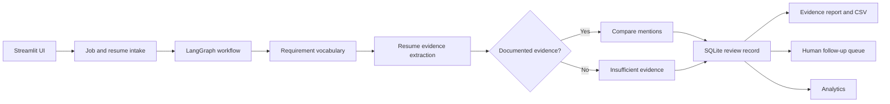

# HireFlow AI — The Evidence Atelier

**An illustrated, human-led recruitment evidence workspace.** HireFlow compares the *documented mentions* in a resume against recognized terms in a job description, presents supporting excerpts, and helps a reviewer record follow-up questions. It does **not** determine candidate suitability.

> **Educational capstone / fictional data only.** Do not use this prototype to rank, screen, reject, or hire real candidates. A keyword match is not proof of competence; a missing match is not proof of inability.

## What you can explore

- **Interactive workspace:** Illustrated Streamlit dashboard, job/date filters, activity charts, and skill constellation.
- **Guided review:** Sample fictional candidates or PDF/DOCX/TXT uploads, document text preview, and a three-stage analysis journey.
- **Evidence trail:** LangGraph requirements → extraction → optional retrieval → comparison/insufficient-evidence branch; saved excerpts and downloadable CSV report.
- **Human follow-up:** Persistent review queue with pending/reviewed/needs-more-information administrative states and reviewer notes.
- **Reproducible demo:** Fictional sample documents, 25 synthetic seeded reviews, golden examples, and automated regression tests.

## Quick start — Windows PowerShell

Run from the repository root, using **Python 3.11**:

```powershell
py -3.11 -m venv .venv
.\.venv\Scripts\Activate.ps1
python -m pip install --upgrade pip
python -m pip install -r requirements.txt
python -m data.seed_demo
python -m streamlit run app/main.py
```

If activation is blocked, use `Set-ExecutionPolicy -Scope Process Bypass` in that terminal and retry. The database is created locally; **no database file or API key is required**. `python -m data.seed_demo` adds 25 explicitly fictional records and avoids duplicating them on repeat runs. To reset *only* the synthetic reviews, use `python -m data.seed_demo --reset-demo`.

In the app: **Start a review → choose a sample job → choose a fictional candidate → Analyze resume → Human review queue**. Use the evidence report's CSV export to inspect the findings.


## Optional Ask the Evidence chatbot and guardrails

After a fictional review, open **Ask the Evidence** to ask questions about saved resume excerpts. The chatbot is optional; without a configured Groq API key, the underlying review workflow still runs and saved excerpts remain viewable. Set `GROQ_API_KEY` and `LLM_MODEL` in your local `.env` to enable natural-language answers. Never commit API keys or real resumes.

The chatbot applies **input guardrails** (question size, obvious prompt-override patterns, and direct hiring/ranking requests), bounds and filters conversation history, and treats resume passages as untrusted data. **Output guardrails** validate the JSON response shape and source IDs, reject some unsafe hiring conclusions, and abstain on invalid responses. Cited excerpts are displayed verbatim for human verification. These are limited, heuristic checks: a valid citation **does not prove** that the cited text supports the answer, and prompt injection or hallucinations cannot be eliminated. This educational prototype is not suitable for real hiring decisions.

Run focused tests with `python -m pytest -q tests/test_evidence_chat.py tests/test_chat_guardrails.py`.

## Tests and reproducible evaluation

```powershell
python -m pytest -q
python -m eval.run_golden
python -m eval.run_stage3
```

The evaluation fixtures are synthetic and exercise known behavior, including negated claims and a prompt-injection example. They are development regression checks, **not an independent accuracy benchmark or validation for hiring**. See [Evaluation methodology](docs/EVALUATION.md).

## Architecture



Full details: [Architecture documentation](docs/ARCHITECTURE.md).

## Configuration and privacy

The default extraction mode is deterministic rules (`EXTRACTION_MODE=rules`), with no external LLM calls required. Optional Groq extraction and Chroma semantic retrieval are experimental; they are not required for the core demo. Use `.env.example` only as a placeholder template; never commit `.env`, API keys, SQLite files, vector databases, or real candidate data.

The MVP stores candidate references, extracted skill mentions, evidence excerpts, and reviewer follow-up notes locally. It does not persist the entire uploaded resume in the main review table. **There is no authentication, role-based access control, OCR, retention policy, or validated hiring assessment.** Negations, synonyms, complex context, and fabricated claims can still be mishandled. Run locally with synthetic data only.

## Repository map

| Path | Purpose |
|---|---|
| `app/main.py` | Streamlit pages and UI |
| `app/graph.py`, `app/agents.py` | Workflow and extraction orchestration |
| `app/tools.py`, `app/validation.py` | Vocabulary and conservative evidence rules |
| `app/database.py`, `app/review_actions.py` | SQLite persistence and human follow-up |
| `app/evidence_report.py`, `app/charts.py` | Reports and visualizations |
| `data/demo/`, `data/seed_demo.py` | Fictional demonstrations |
| `eval/`, `tests/` | Golden cases, Stage 3 checks, regression tests |
| `docs/` | Architecture and evaluation notes |

## Screenshots

Add screenshots from the running app to `docs/screenshots/` (dashboard, guided review, evidence report, human review queue) before submission. Screenshots are intentionally not fabricated in this repository.

## Design principle

**Look closer. See clearer.** The watercolor-inspired interface invites exploration; the evidence-first workflow deliberately leaves interpretation and employment decisions to people.
