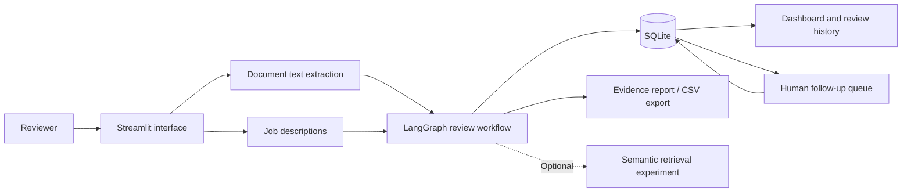
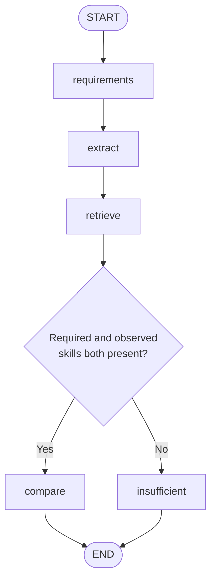
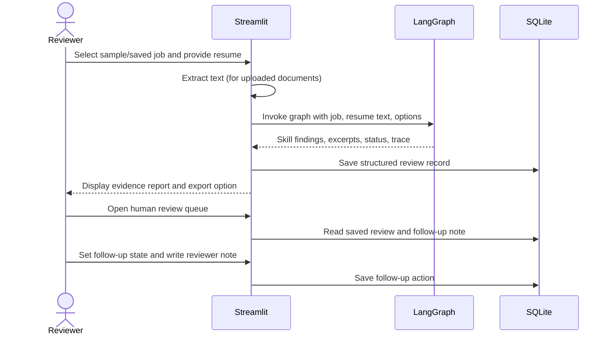

HireFlow AI — System Architecture
Project type: Educational, human-reviewed recruitment evidence workspace
Stack: Python · Streamlit · LangGraph · SQLite · Plotly
Scope: Local prototype using fictional candidate data. Not an automated hiring or candidate-ranking system.

1. System overview
HireFlow compares the requirements mentioned in a job description with skill mentions and supporting excerpts extracted from a resume. It records the result for a human reviewer to inspect and annotate. A missing mention means not evidenced in the submitted document, not that a person lacks the skill.

The interface is the entry point. The workflow analyzes document text; the database persists structured review records and reviewer follow-up notes. Plotly visualizations summarize saved reviews. Semantic retrieval is optional and is not a production-grade, persistent policy-RAG or hiring decision system.
2. Application layers
Layer	Key modules	Responsibility
Presentation	app/main.py, app/styles.py, app/ui_components.py	Dashboard, guided review, job management, human follow-up, visual styling
Analytics	app/charts.py	Review activity, reviewer status, and evidenced-requirement charts
Document ingestion	app/document.py	Extract text from supported PDF, DOCX, and TXT uploads
Workflow orchestration	app/graph.py, app/schemas.py	LangGraph state, node execution, conditional routing, execution trace
Evidence analysis	app/agents.py, app/tools.py	Vocabulary-based skill identification, requirement comparison, source excerpts
Optional retrieval	app/rag.py	Experimental semantic retrieval of resume passages when enabled
Persistence	app/database.py, app/review_actions.py	SQLite jobs, review records, and reviewer follow-up states/notes
Reporting	app/evidence_report.py	Evidence-focused presentation, workflow trace, CSV export
Demonstration & evaluation	data/demo/, data/seed_demo.py, eval/, tests/	Fictional sample inputs, reproducible demo records, golden cases, regression tests

Module names describe the current project structure. Optional or experimental capabilities are not required for the standard rules-based demonstration.

3. LangGraph review workflow
The graph in app/graph.py uses a ReviewState and executes the following path:

1. requirements — identify recognized requirements in the job description using the configured vocabulary.
2. extract — identify observed resume skills and associated excerpts through the extraction component.
3. retrieve — skip retrieval by default; when explicitly enabled, attempt semantic passage retrieval. Retrieval failures are recorded as notes rather than stopping the workflow.
4. compare — compare recognized requirements with observed skills and return evidenced and not-evidenced lists. The workflow status is human_review_required.
5. insufficient — when requirements or observed skills are absent, return insufficient_evidence and route the record for human interpretation.
The graph maintains a trace of visited steps for the current run. Graph status is not the same as a human review outcome. The graph does not approve, reject, rank, or score candidates.
4. Review lifecycle and data flow

Main user journeys
- Home: View review metrics, activity charts, status distribution, and recent records.
- Manage jobs: Create job descriptions or start from fictional examples.
- Start a review: Choose a job, select a fictional resume or upload a document, run the graph, inspect the evidence report, and export results.
- Human review queue: Open a saved review, inspect supporting excerpts, and save a follow-up note and status.
5. Storage model
The SQLite database is created locally at data/hireflow.db by default; DATABASE_PATH can override its location.
Table	Important fields	Purpose
jobs	id, title, description, created_at	Saved job descriptions
reviews	id, job_id, candidate_name, observed_skills, supported_skills, missing_skills, evidence_json, status, created_at	Structured analysis history
Human review actions	Review reference, follow-up state, reviewer note	Human administrative follow-up, managed by app/review_actions.py

The review's skill lists and evidence passages are serialized as JSON within SQLite text columns. The application stores candidate references and extracted excerpts, not the complete uploaded resume text in the core review table. It is a local single-user prototype, not a secured multi-user records system.
Status distinction
- Analysis status: human_review_required or insufficient_evidence, produced by the graph.
- Human follow-up state: pending, reviewed, or needs_more_information, managed separately by the reviewer.
These states are for document verification and follow-up only; none represents a hiring decision.
6. Evidence and retrieval boundaries
The default demonstration uses deterministic, vocabulary-based extraction. This makes runs easier to reproduce, but limits what the system can understand. The extractor can miss synonyms, interpret negated statements incorrectly, or confuse a mention of a technology with demonstrated experience. Evidence excerpts should therefore always be checked against the original document.

Optional semantic retrieval can supply additional passages, but is not a verified source of qualifications and is not part of an automated employment decision. The system does not currently provide production LLM extraction, a robust skill ontology, resume OCR, or persistent policy-grounded RAG.
7. Testing and reproducibility
From the repository root, install the dependencies and run:
python -m pytest -q
python -m eval.run_golden
For the guided local app:
python -m streamlit run app/main.py
If data/seed_demo.py is included in your checked-in version, you can populate fictional demonstration records with:
python -m data.seed_demo
The data/demo/ JSON fixtures let reviewers try the workflow without uploading personal resumes. The eval/ and tests/ folders provide repeatable evaluation and regression checks; results should be reported from an actual test run rather than assumed.
8. Privacy, safety, and deployment limitations
- Use fictional data only. Do not upload real candidate records to a publicly shared demo.
- No automated hiring decisions. The tool does not assess competence or suitability for employment.
- No authentication or role-based access. Do not deploy it for real recruitment operations.
- No validated fairness or accuracy guarantees. Keyword matches and missing evidence require human interpretation.
- No production security/retention controls. The local database should be excluded from version control; API keys and .env files must never be committed.
- No OCR. Scanned/image-only resumes may not yield usable text.
9. Future evolution
Potential future work includes validated structured extraction, richer evidence attribution, a controlled skill taxonomy, more robust evaluation for negation and ambiguous claims, authentication, privacy/retention policies, accessibility testing, and deployment hardening. These are planned improvements, not current capabilities.
Design principle: Evidence first, human judgment always.